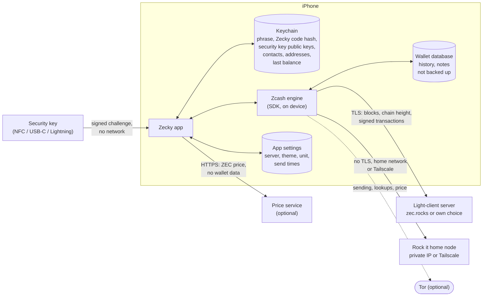

# Zecky Lock it: threat model and data flow

Version 0.0.19 (iOS). For auditors and for ourselves: what Zecky Lock it
protects, from whom, how, and what it does not try to do.

## What it protects

1. **The recovery phrase** (24 words) and the keys derived from it. Whoever
   has them controls the funds.
2. **The funds**: no payment leaves the wallet unless the owner sends it,
   and no payment goes out twice.
3. **Privacy**: balance, history, addresses and notes stay on the phone.
   Servers learn as little as the Zcash light-client protocol allows.

## Who it protects against

| Adversary | Examples | In scope |
| --- | --- | --- |
| Someone holding the unlocked phone | partner, thief, border check | Yes |
| Someone looking at the screen | shoulder surfing, app switcher, screenshots | Partly |
| The light-client server | public server, a malicious server | Yes, for privacy and correctness |
| The network | Wi-Fi owner, ISP | Yes, with TLS; Tor optional |
| The price service | public price API | Yes, it learns only the IP address |
| Backups | iCloud or computer backup | Yes |
| Other apps on the phone | third-party keyboards, clipboard readers | Partly |
| A jailbroken or compromised iPhone | malware with root | No |
| The Zcash protocol and the SDK | cryptographic flaws | No (relied on) |
| The owner losing the paper | | No; stated plainly in the app |

## How

**Phrase and keys**
- Generated on the phone from the system's secure random source. Stored only
  in the iOS Keychain, `WhenUnlockedThisDeviceOnly`: not in iCloud Keychain,
  not in backups, not readable while the phone is locked.
- Never sent anywhere, never logged, never put on the clipboard. Only Apple's
  keyboard is allowed in the app (third-party keyboards are refused), so
  typing the phrase on restore cannot be recorded by another app.
- Shown only on request. Guarded by the Zecky code if set, otherwise by Face ID
  or the iPhone passcode (a Keychain item with `userPresence`). The viewing
  key is guarded the same way. Without an
  iPhone passcode the phrase is shown with a line saying it is unprotected.
- The words leave the screen when the page closes or the app goes to the
  background. The app switcher shows a cover instead of the app.
- Deleting Zecky removes the wallet: iOS keeps Keychain items after an app
  is deleted, so the first start after an install clears them. An update is
  told apart by the wallet's own files (kept on update, deleted with the app)
  and Zecky's settings; when in doubt it keeps.
- Erase wallet (guarded like viewing the phrase) removes the phrase, every
  other Keychain item, the wallet database and every setting.

**Keys to the lock** (Settings › Security)
- How Zecky checks it is the owner: Face ID / the iPhone passcode, or the
  Zecky code. Showing the phrase or the viewing key and erasing always ask.
  Opening Zecky and opening the lock ask unless switched off (opening Zecky
  is off by default without a Zecky code).
- Opening the lock first asks "Really open the lock?" with a tick and a 10 s
  wait (5 s, 3 s or off). This guards against being rushed or coached, not
  against a thief. The open lock closes after a release, after two minutes,
  or when Zecky leaves the foreground; leaving also closes Release.
- Weakening any of this (switching a check off, a shorter wait, turning the
  code off) and choosing a new Zecky code first ask the owner, so someone
  with the unlocked phone cannot quietly lower the guard.
- These choices are app settings (UserDefaults), deleted with the app and
  reset by Erase. With both checks and the question off, one tap opens the
  lock: the owner's explicit choice.

**Security key** (FIDO2, phase 1; Settings › Security › Keys to the lock ④)
- Optional. A FIDO2 security key (NFC, USB-C or Lightning) is asked right
  before every release: the check sits in the wallet's sendProposal, before
  createTransfer, so no screen can skip it. Locking in from the public
  address is not a release and asks no key.
- Pairing and checking go through Apple's AuthenticationServices sheet for
  the relying party zecky.app (Associated Domains `webcredentials:zecky.app`;
  zecky.app serves `/.well-known/apple-app-site-association`). No network
  traffic from the app: iOS fetches the association file from Apple's CDN.
- Each check uses a fresh 32-byte challenge from SecRandomCopyBytes. The
  answer's contents (rpIdHash of zecky.app, user-present flag, type,
  challenge, known credential ID, sign counter not going backwards) are
  checked in `src/lib/webauthn.ts`; the ES256 signature over
  authenticatorData ‖ SHA-256(clientDataJSON) with CryptoKit.
- Non-resident credential, random user ID, no name or email: the key holds
  nothing about the owner and lists no Zecky login. Stored on the phone:
  credential IDs, public keys and counters, in their own this-device-only
  Keychain item, cleared by Erase and on a fresh install.
- Adding a second key, removing a key, switching off "ask the key for the
  phrase" and cancelling a removal ask a tap of a paired key, so someone
  with the phone and its passcode cannot add their own key or take yours
  away. The first key asks the owner (code or Face ID).
- "Lost my keys": starts with the owner check and takes effect only after
  48 hours on both the clock and the Zcash network (2,304 blocks), so
  setting the date forward alone does not shorten it; a key tap cancels it,
  and Home shows it while it runs. A malicious server reporting a false
  height together with a changed clock could shorten it: known limit.
- Known griefing path (re-check R10): someone who knows the passcode can
  add the first key (their own) and switch on "ask the key for the phrase",
  blocking the owner's releases and phrase for the 48-hour removal, which
  only their key can cancel. No worse than a passcode holder reading the
  phrase today; the phrase option is off by default and needs two keys.
- Optional: the key also guards showing the recovery phrase (needs two
  keys; the owner is warned that losing all keys and the paper loses the
  funds).
- Limits: phase 1 is an app-level gate. Whoever has the 24 words can spend
  with any wallet, and a compromised phone can skip any app check. Phase 2
  (encrypting the stored phrase with the key's PRF secret, iOS 26.4+) is
  planned together with audit K1.

**Zecky code** (called "app code" before 0.0.18)
- 4 digits, stored only as a salted PBKDF2-SHA256 hash (10,000 rounds) in the
  Keychain. A screen lock, not encryption. After 5 wrong codes, growing waits
  up to 15 minutes. The counter survives closing and restarting Zecky and
  does not use the clock, so changing the date does not skip it. Deleting
  the app clears it, together with the wallet itself.

**Funds**
- Every release shows a receipt first: recipient, amount, fee, total released
  and what stays locked. Release is only reachable through an open lock.
- Offline, nothing is created. With a home node on mobile data, the node is
  asked first.
- A payment that was created but not delivered is stored by the engine and
  resent until mined or expired (about 40 blocks). The app says so and
  removes the send button, and warns on the next send while one is waiting,
  so a payment is never made twice by retrying.
- Received funds are only spendable after the engine's confirmations; the
  balance says how much is "available in a few minutes".

**Privacy**
- Lock more shows a shielded unified address, and a fresh never-used one once
  the shown one has been paid.
- Wallet files are excluded from iCloud and computer backups: the whole Documents folder, so files the engine creates later are covered too (self-audit D2).
- Connections: the light-client server over TLS; a home node (Rock it) on a
  private address without TLS, inside the home network or Tailscale only
  (exactly four-number private IPv4 ranges qualify). Optional Tor for
  releases, payment lookups and the price. While Tor is wanted but not
  connected (starting or failed), releases and lock-ins are refused: the
  engine falls back to a direct connection when Tor cannot start, so going
  ahead would expose the IP address (self-audit N1, 27 Oct 2026).
- Tor and the own node (self-audit N6): with Rock it as the server the
  wallet does not use Tor (status "ownNode"), also when Tor is wanted. Tor
  hides the IP address from the server, which is the owner's own here, and a
  Tor exit cannot resolve or reach a home or Tailscale address (the failure
  seen in N6: "remote hostname lookup failure"). The price still goes over
  Tor. Rock it relays releases to the Zcash network from the home
  connection. With a public server, a failed Tor submit is retried at once,
  up to twice, through a fresh circuit (the failed group is dropped); a
  rejection by the server is not retried.
- NU7 (block 3,543,405, Nov 2026): the engine in this build (react-native-
  zcash 0.13.5, Swift SDK 2.7.0-rc.4) does not know NU7's consensus branch,
  so from 40 blocks before activation Zecky builds no transaction at all
  (releases, lock-ins and their proposals refuse with a clear message;
  `src/lib/upgrades.ts`, ENGINE_KNOWS_NU7). Receiving, syncing and balances
  are unaffected. Block-time-based logic counts 25-second blocks from NU7
  (confirmation estimates, the 48-hour key removal, birthday estimates).
- Own node identity (self-audit N2, re-check R3/R4): only a …ts.net name
  added from Rock it's QR code (saved with an "own" mark) counts as a
  verified own node: it is reached over TLS for a name only the owner's
  tailnet has. A …ts.net name typed by hand is treated as a public server
  (Tailscale Funnel publishes such names), so Tor stays on for it. A
  100.64/10 address (also used for carrier-grade NAT) and a home-network
  address (10/8, 172.16/12, 192.168/16) go without TLS and cannot be
  authenticated: on another network a different device at the same
  address could pose as Rock it (hide or delay payments; it cannot move
  funds). Zecky labels them apart and recommends the Tailscale name. Full
  fix planned: Rock it serves TLS with its own certificate, pinned from its
  QR.
- Notes (memos) are shown as plain text; a note with a link gets a warning.

## Data flow

What leaves the phone:

| To | What | Never |
| --- | --- | --- |
| Light-client server | requests for compact blocks and the chain height; signed transactions to broadcast; the phone's IP address (unless Tor) | phrase, keys, viewing keys, balance |
| Rock it node | the same, but to the owner's own node | the same |
| Price service | a price request and the IP address (none with "None" or Tor) | anything about the wallet |
| Apple | nothing from Zecky beyond what iOS itself sends; iOS fetches zecky.app's association file through Apple's CDN when the app is installed or updated | |
| zecky.app | nothing: the app never contacts the website | |

## Out of scope and known limits

- A compromised or jailbroken phone can read anything the app can.
- Screenshots of the phrase are not blocked (iOS gives apps no way to). While the screen is recorded or mirrored, Zecky hides behind its lock cover (self-audit K2). The capture and app-switcher covers are separate windows above all sheets and alerts, modal for VoiceOver (re-check R9).
- The light-client server sees the IP address (without Tor) and when the
  wallet syncs and sends.
- The Zecky code is not encryption: someone who can read the Keychain does not
  need it.
- Restoring with a birthday later than the first transaction can hide older
  history; the SDK currently rounds birthdays down to its latest checkpoint.
- Not yet independently audited.
