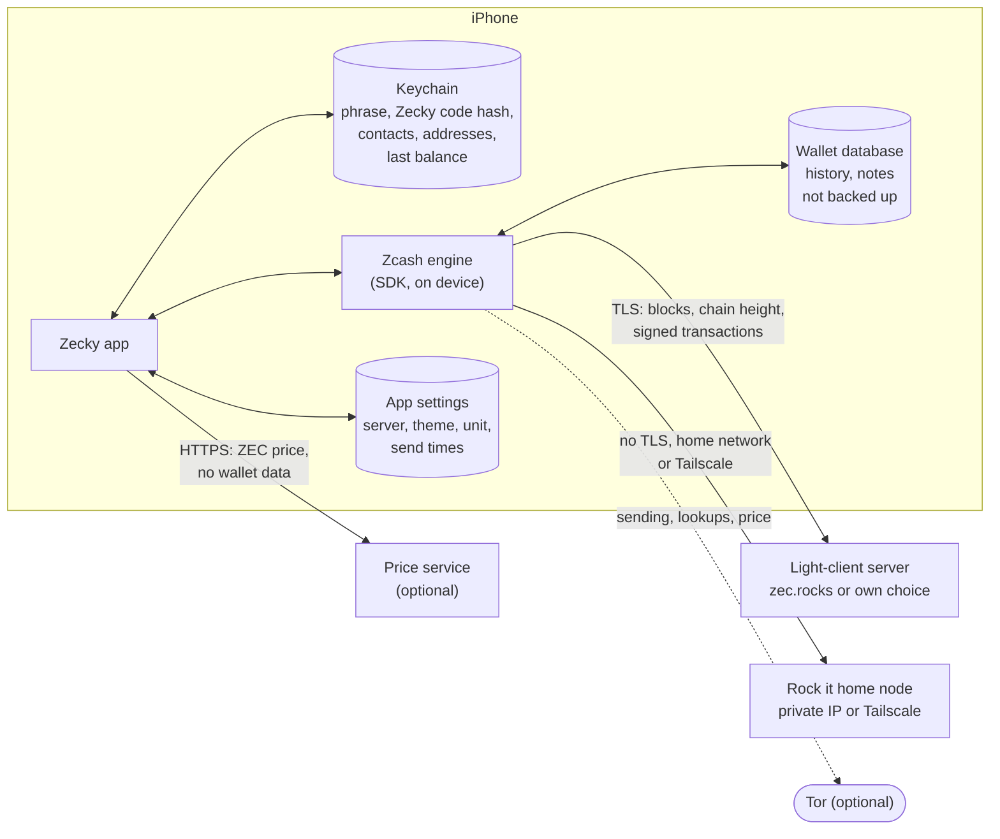

# Zecky Lock it: threat model and data flow

Version 0.0.17 (iOS). For auditors and for ourselves: what Zecky Lock it
protects, from whom, how, and what it does not try to do.

## What it protects

1. **The recovery phrase** (24 words) and the keys derived from it. Whoever
   has them controls the funds.
2. **The funds**: no payment leaves the wallet unless the owner sends it,
   and no payment goes out twice.
3. **Privacy**: balance, history, addresses and notes stay on the phone.
   Servers learn as little as the Zcash light-client protocol allows.

## Who it protects against

| Adversary | Examples | In scope |
| --- | --- | --- |
| Someone holding the unlocked phone | partner, thief, border check | Yes |
| Someone looking at the screen | shoulder surfing, app switcher, screenshots | Partly |
| The light-client server | public server, a malicious server | Yes, for privacy and correctness |
| The network | Wi-Fi owner, ISP | Yes, with TLS; Tor optional |
| The price service | public price API | Yes, it learns only the IP address |
| Backups | iCloud or computer backup | Yes |
| Other apps on the phone | third-party keyboards, clipboard readers | Partly |
| A jailbroken or compromised iPhone | malware with root | No |
| The Zcash protocol and the SDK | cryptographic flaws | No (relied on) |
| The owner losing the paper | | No; stated plainly in the app |

## How

**Phrase and keys**
- Generated on the phone from the system's secure random source. Stored only
  in the iOS Keychain, `WhenUnlockedThisDeviceOnly`: not in iCloud Keychain,
  not in backups, not readable while the phone is locked.
- Never sent anywhere, never logged, never put on the clipboard. Only Apple's
  keyboard is allowed in the app (third-party keyboards are refused), so
  typing the phrase on restore cannot be recorded by another app.
- Shown only on request. Guarded by the Zecky code if set, otherwise by Face ID
  or the iPhone passcode (a Keychain item with `userPresence`). The viewing
  key is guarded the same way. Without an
  iPhone passcode the phrase is shown with a line saying it is unprotected.
- The words leave the screen when the page closes or the app goes to the
  background. The app switcher shows a cover instead of the app.
- Deleting Zecky removes the wallet: iOS keeps Keychain items after an app
  is deleted, so the first start after an install clears them. An update is
  told apart by the wallet's own files (kept on update, deleted with the app)
  and Zecky's settings; when in doubt it keeps.
- Erase wallet (guarded like viewing the phrase) removes the phrase, every
  other Keychain item, the wallet database and every setting.

**Keys to the lock** (Settings › Security)
- How Zecky checks it is the owner: Face ID / the iPhone passcode, or the
  Zecky code. Showing the phrase or the viewing key and erasing always ask.
  Opening Zecky and opening the lock ask unless switched off (opening Zecky
  is off by default without a Zecky code).
- Opening the lock first asks "Really open the lock?" with a tick and a 10 s
  wait (5 s, 3 s or off). This guards against being rushed or coached, not
  against a thief. The open lock closes after a release, after two minutes,
  or when Zecky leaves the foreground; leaving also closes Release.
- Weakening any of this (switching a check off, a shorter wait, turning the
  code off) and choosing a new Zecky code first ask the owner, so someone
  with the unlocked phone cannot quietly lower the guard.
- These choices are app settings (UserDefaults), deleted with the app and
  reset by Erase. With both checks and the question off, one tap opens the
  lock: the owner's explicit choice.

**Zecky code** (called "app code" before 0.0.18)
- 4 digits, stored only as a salted PBKDF2-SHA256 hash (10,000 rounds) in the
  Keychain. A screen lock, not encryption. After 5 wrong codes, growing waits
  up to 15 minutes; the counter survives reinstalling and does not use the
  clock, so changing the date does not skip it.

**Funds**
- Every release shows a receipt first: recipient, amount, fee, total released
  and what stays locked. Release is only reachable through an open lock.
- Offline, nothing is created. With a home node on mobile data, the node is
  asked first.
- A payment that was created but not delivered is stored by the engine and
  resent until mined or expired (about 40 blocks). The app says so and
  removes the send button, and warns on the next send while one is waiting,
  so a payment is never made twice by retrying.
- Received funds are only spendable after the engine's confirmations; the
  balance says how much is "available in a few minutes".

**Privacy**
- Lock more shows a shielded unified address, and a fresh never-used one once
  the shown one has been paid.
- Wallet files are excluded from iCloud and computer backups.
- Connections: the light-client server over TLS; a home node (Rock it) on a
  private address without TLS, inside the home network or Tailscale only
  (exactly four-number private IPv4 ranges qualify). Optional Tor for
  sending, payment lookups and the price.
- Notes (memos) are shown as plain text; a note with a link gets a warning.

## Data flow

What leaves the phone:

| To | What | Never |
| --- | --- | --- |
| Light-client server | requests for compact blocks and the chain height; signed transactions to broadcast; the phone's IP address (unless Tor) | phrase, keys, viewing keys, balance |
| Rock it node | the same, but to the owner's own node | the same |
| Price service | a price request and the IP address (none with "None" or Tor) | anything about the wallet |
| Apple | nothing from Zecky beyond what iOS itself sends | |

## Out of scope and known limits

- A compromised or jailbroken phone can read anything the app can.
- Screenshots and screen recording of the phrase are not blocked.
- The light-client server sees the IP address (without Tor) and when the
  wallet syncs and sends.
- The Zecky code is not encryption: someone who can read the Keychain does not
  need it.
- Restoring with a birthday later than the first transaction can hide older
  history; the SDK currently rounds birthdays down to its latest checkpoint.
- Not yet independently audited.
